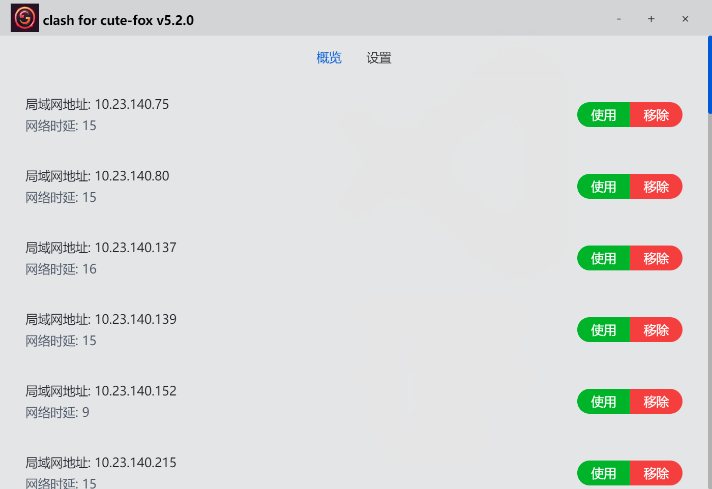
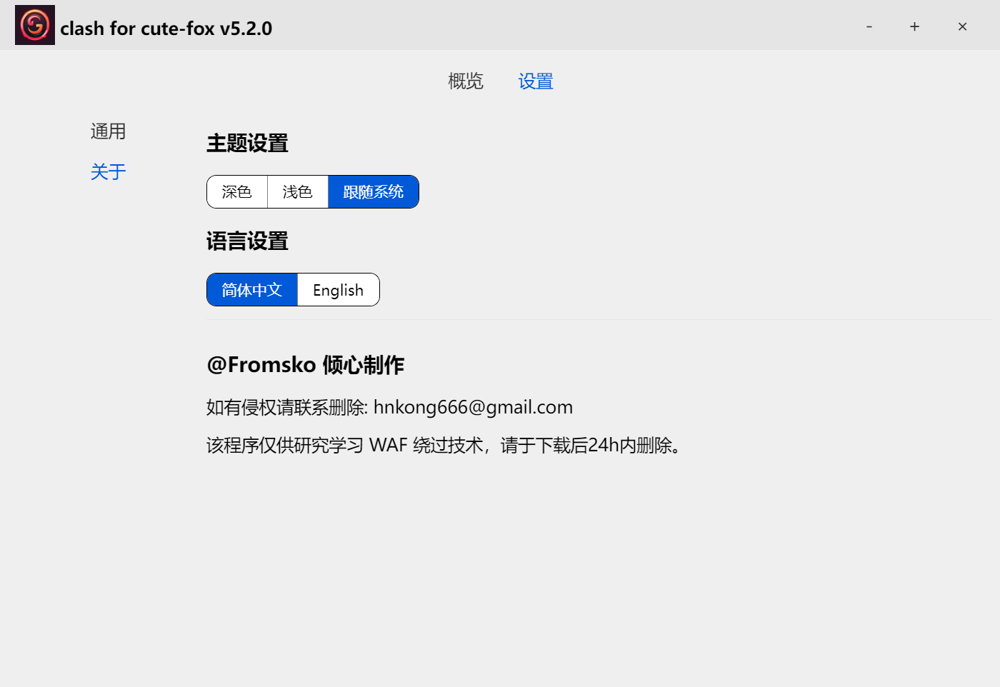
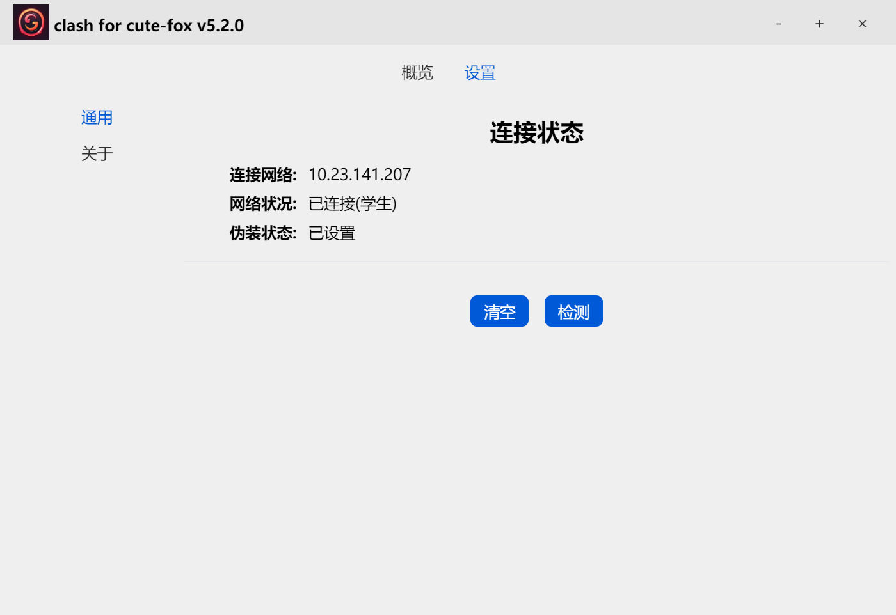

# Dr-net

Dr.com 校园网 WAF 绕过（模拟登录）

> 仅适用于 HNIU 校园网

## 开发

- 拉取依赖

  ```shell
  go mod tidy
  ```

- 获取 `wails`

  ```shell
  go install github.com/wailsapp/wails/v2/cmd/wails@latest
  ```

- 编译构建

  ```shell
  wails build -upx -nsis
  ```

- 可选依赖
  - [`UPX`](https://upx.github.io/) 用于压缩您的应用程序。
  - [`NSIS`](https://wails.io/docs/guides/windows-installer/) 用于生成 Windows 安装程序。

## 界面

- `主界面`
  
- `管理页面`
  
- `连接页面`
  

## 使用

1. 开始扫描
2. 点击使用(同时只能有一个被使用)
3. 设置 - 检测(查询网络状态)
4. 清空(移除所有扫描结果|恢复网络)

## 贡献

- 开发模板

  ```shell
  wails init -n myproject -t vue-ts
  ```

- 开发模式

  ```shell
  wails dev
  ```

- 构建模式(携带`debug`)

  > -windowsconsole 保留控制台
  >
  > --debug 启用 debug 模式

  ```shell
  wails build --debug
  ```

- 构建模式(打包+压缩)

  > -s 跳过前端构建
  >
  > -upx 压缩
  >
  > -nsis `Win` 打包程序

  ```shell
  wails build -upx -nsis
  ```

## 鸣谢

- [wails](https://wails.io) - GO语言流行的GUI库
- [arp-scan](https://github.com/QbsuranAlang/arp-scan-windows-) - C 实现的`arp`扫描
- [scanPort](https://github.com/xs25cn/scanPort) - Go 实现的端口扫描工具
- [fyne](https://github.com/fyne-io/fyne) - Go 流行的`GUI`框架
- [qinglong](https://github.com/whyour/qinglong) - 定时任务管理平台
- [port-forward](https://github.com/tavenli/port-forward) - Go 实现的端口转发工具
